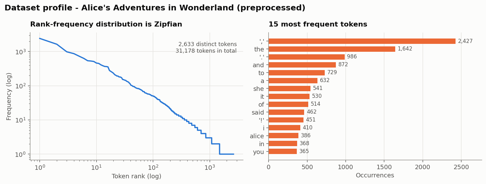
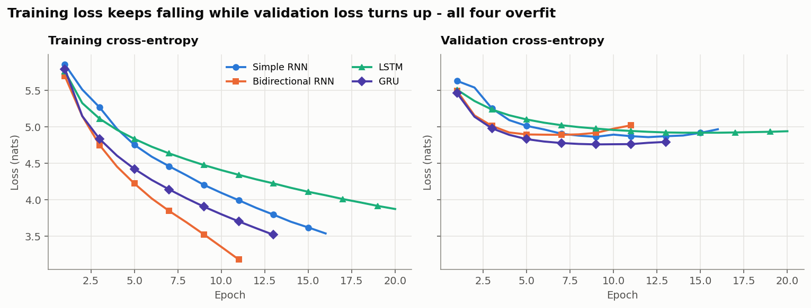
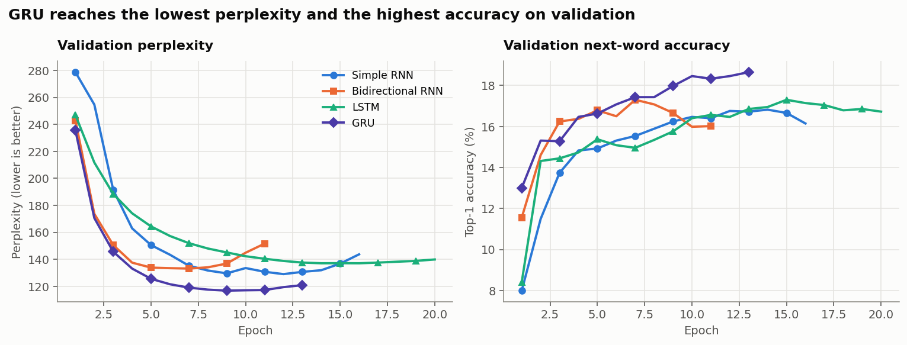
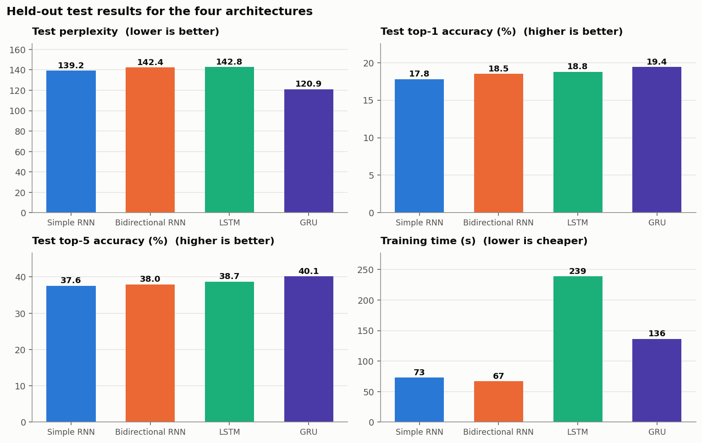
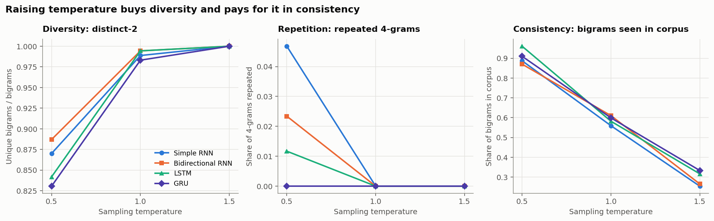

# Autoregressive Next-Word Text Generation with Recurrent Neural Networks

**Foundations of Generative AI (ICT4403) — Assignment 2**

A word-level autoregressive language model built four ways — **Simple RNN**, **Bidirectional RNN**,
**LSTM** and **GRU** — trained under identical conditions on *Alice's Adventures in Wonderland*, compared
quantitatively and qualitatively, and used to generate text at three sampling temperatures.

Every number, table, figure and text sample in this repository was produced by executing the code here.
Nothing is estimated or copied from elsewhere. The full run takes **8.6 minutes on a CPU**.

---

## Problem statement and objective

An autoregressive language model factorises the probability of a word sequence into a product of
next-word conditionals:

```
p(w₁ … w_T) = ∏ₜ p(wₜ | wₜ₋ₖ … wₜ₋₁)
```

Given a fixed context window of **k = 20** words, each model learns `p(wₜ | context)` over the corpus
vocabulary. Text is generated by sampling one word at a time and feeding it back as part of the next
context — which is what makes generation *autoregressive*.

**Objective.** Determine which recurrent cell is the most effective autoregressive generator for this
dataset, by:

1. **Task (i)** — characterising and preprocessing the corpus, constructing input→target sequences, and
   training all four architectures under comparable conditions.
2. **Task (ii)** — comparing them quantitatively (loss, perplexity, next-word accuracy, training time) and
   qualitatively (coherence, diversity, contextual consistency, repetition).
3. **Task (iii)** — generating from the same seed sequences at three sampling temperatures and analysing
   temperature's influence on coherence, diversity and repetition.

---

## Dataset

**Alice's Adventures in Wonderland** by Lewis Carroll — **Project Gutenberg eBook #11**.

| | |
|---|---|
| Landing page | <https://www.gutenberg.org/ebooks/11> |
| Plain-text file downloaded by the code | <https://www.gutenberg.org/cache/epub/11/pg11.txt> |
| Licence | Public domain in the United States; distributed free of restriction by Project Gutenberg |

`src/data.py` downloads this file directly and caches it in `data/raw/`. No manual download is needed.

**Why this dataset.** A single self-contained work of narrative English with a consistent authorial voice,
a small recurring cast and a great deal of direct speech. It is large enough for a word-level model to
learn real structure, small enough that four models can be trained honestly on a CPU, and distinctive
enough that differences in coherence and repetition are visible to the naked eye in the generated text.

### Characteristics (measured, after preprocessing)

| Characteristic | Value |
|---|---|
| Raw file | 167,712 characters |
| Body after licence header/footer and table of contents removed | 147,989 characters |
| Total tokens (words + sentence punctuation) | **31,178** |
| Word tokens excluding punctuation | 26,685 |
| Distinct tokens before frequency filtering | 2,633 |
| *Hapax legomena* (tokens occurring exactly once) | 1,139 — **43.26%** of the vocabulary |
| Minimum word frequency kept | 2 |
| **Final vocabulary** (including `<pad>`, `<unk>`) | **1,496** |
| Token coverage by the final vocabulary | **96.35%** |
| Type–token ratio | 0.0844 |
| Sentences (delimited by `.` `!` `?`) | ~1,640, averaging 19.0 tokens |
| Context window | 20 tokens |
| Sequences generated | 31,158 → **24,926 train / 3,115 validation / 3,117 test** |

Two properties matter for modelling. First, **over 40% of the vocabulary occurs exactly once** — those
words cannot be learned and each would add a column to the softmax, so they are mapped to `<unk>`; the
remaining 1,496 types still cover 96.35% of all occurrences. Second, the rank–frequency distribution is
**Zipfian** (a near-straight line on log–log axes), so a handful of function words dominate the corpus.
That is why a model can reach a respectable perplexity while still being weak on the content words that
actually carry meaning.



---

## Preprocessing and sequence construction

`src/data.py` applies, in order:

1. **Boilerplate removal** — everything outside the `*** START/END OF THE PROJECT GUTENBERG EBOOK ***`
   markers is discarded, then the title block and table of contents are dropped by cutting at the *last*
   occurrence of the chapter-one heading. (The table of contents lists all twelve chapter titles and would
   otherwise teach the models a list-like pattern that never occurs in the narrative.)
2. **Unicode normalisation** — curly quotes, em/en dashes and ellipses folded to ASCII; the underscores
   Gutenberg uses for italics stripped.
3. **Lower-casing**, so `The` and `the` share one embedding.
4. **Word-level tokenisation** with `[a-z]+(?:'[a-z]+)*|[.,!?;:]`. Words keep internal apostrophes
   (`don't`, `alice's`), and **sentence punctuation is kept as its own token** — without it the generated
   text would have no sentence boundaries and coherence could not be judged.
5. **Vocabulary construction** — index 0 is `<pad>`, index 1 is `<unk>`, the rest ordered by frequency.

**Input→target construction.** A sliding window of stride 1:

```
X[i] = ids[i : i+20]     the 20-word context the model may look at
y[i] = ids[i + 20]       the single next word it must predict
```

Each example is one term of the autoregressive factorisation.

> **The split is contiguous, not random — deliberately.** Consecutive windows share 19 of their 20 tokens.
> Shuffling before splitting would place near-duplicates of training contexts into validation and test and
> inflate every reported score. The corpus is therefore cut into three contiguous blocks (first 80% / next
> 10% / final 10%) so held-out text is genuinely unseen.

---

## The four models

Every model is identical apart from its recurrent core, which is what makes the comparison fair:

```
Embedding(vocab, 100) → ⟨recurrent core⟩ → Dropout(0.2) → Dense(vocab, softmax)
```

| Model | Core | How it works | Parameters |
|---|---|---|---|
| **Simple RNN** | `SimpleRNN(128)` | One tanh recurrence, `hₜ = tanh(W xₜ + U hₜ₋₁ + b)`. The baseline — cheapest, but gradients vanish over long spans, so in practice it remembers only the last few words. | 371,896 |
| **Bidirectional RNN** | `Bidirectional(SimpleRNN(128))` | Encodes the *context window* forwards and backwards and concatenates both final states (256 features). Richer encoding of available context, at roughly double the recurrent parameters. | 592,696 |
| **LSTM** | `LSTM(128)` | Adds a cell state with input/forget/output gates, so information can be carried unchanged across many steps. Most expressive, ~4× the gate parameters, slowest. | 459,832 |
| **GRU** | `GRU(128)` | Reset and update gates only — most of the LSTM's benefit with one fewer gate and no separate cell state. Fewer parameters to fit, which suits a small corpus. | 430,904 |

### Is a bidirectional model legitimate here?

This is the subtle point of the assignment, so it is worth being explicit. A bidirectional layer is
normally ruled out for language modelling because it would see the future. **Here it does not.** The model
predicts `wₜ` from the window `wₜ₋₂₀ … wₜ₋₁`, and the backward pass runs over *that window only* — it never
touches `wₜ`. The target is not leaked, and generation stays strictly autoregressive: each sampled word is
appended to the window and the whole window is re-encoded in both directions before the next word is
drawn. What bidirectionality buys is a richer encoding of context that is *already available*; what it
costs is twice the recurrent parameters — and, as the results show, it does not pay for itself.

### Identical training conditions

| Setting | Value |
|---|---|
| Context window | 20 tokens |
| Embedding dimension | 100 |
| Recurrent units | 128 |
| Dropout | 0.2 |
| Optimiser | Adam, learning rate 1e-3 |
| Loss | Sparse categorical cross-entropy |
| Batch size | 128 |
| Epoch budget | 30, early stopping on validation loss (patience 4, best weights restored) |
| Random seed | 42, reset before each model is built |

---

## Execution steps and dependencies

**Dependencies** (`requirements.txt`) — the exact versions the reported results were produced with:

```
tensorflow==2.20.0rc0   keras==3.11.1   numpy==2.3.2   pandas==2.3.1   matplotlib==3.10.5
notebook==7.4.4         ipykernel==6.30.0
```

```bash
pip install -r requirements.txt
```

**Option A — run the whole pipeline as a script:**

```bash
cd src
python run_all.py
```

**Option B — run the notebook** (same code; it imports the same modules):

```bash
jupyter notebook notebooks/autoregressive_text_generation.ipynb
```

Either path downloads the dataset, trains all four models, writes every metric table, figure and text
sample into `results/`, and prints the comparison. No GPU, no manual downloads, no API keys.

### Repository layout

```
ICT4403-Assignment2/
├── notebooks/autoregressive_text_generation.ipynb   executed notebook, outputs included
├── src/
│   ├── config.py      all hyper-parameters and paths in one place
│   ├── data.py        download, clean, tokenise, vocabulary, input→target sequences
│   ├── models.py      the four architectures
│   ├── train.py       identical training loop per model, quantitative metrics
│   ├── generate.py    temperature sampling + automatic text-quality measures
│   ├── evaluate.py    temperature sweep and all figures
│   └── run_all.py     end-to-end entry point
├── data/raw/          the downloaded Gutenberg text (cached)
└── results/
    ├── metrics/       dataset_statistics.json, model_comparison.csv, training_history.csv,
    │                  generation_quality.csv, generation_quality_by_temperature.csv, run_info.json
    ├── plots/         five figures (PNG)
    ├── samples/       generated_samples.md — all 36 generated passages
    ├── logs/          per-epoch CSV logs and architecture summaries
    └── models/        the four trained models (.keras)
```

---

## Results obtained

**Hardware and runtime.** Intel 12-logical-core CPU (Intel64 Family 6 Model 186), Windows 11,
Python 3.13.5, TensorFlow 2.20.0-rc0 / Keras 3.11.1. **No GPU — CPU only.** All four models together
trained in **514.8 seconds (8.6 minutes)**.

### Quantitative comparison (held-out test set)

| Model | Parameters | Epochs (best) | Train time | s/epoch | Test loss | **Test perplexity** | **Top-1 acc** | Top-5 acc |
|---|---:|---:|---:|---:|---:|---:|---:|---:|
| Simple RNN | 371,896 | 16 (12) | 72.9 s | 4.56 | 4.9361 | 139.22 | 17.81% | 37.57% |
| Bidirectional RNN | 592,696 | 11 (7) | 66.7 s | 6.07 | 4.9584 | 142.36 | 18.51% | 37.95% |
| LSTM | 459,832 | 20 (16) | 238.7 s | 11.93 | 4.9611 | 142.75 | 18.77% | 38.72% |
| **GRU** | 430,904 | 13 (9) | 136.4 s | 10.49 | **4.7953** | **120.94** | **19.41%** | **40.13%** |

*Perplexity = e^(cross-entropy): the effective number of equally likely words the model is choosing
between at each step. A uniform guess over this vocabulary would score ≈ 1,496.*







### Qualitative measures — made checkable

"Coherence", "diversity" and "repetition" are easy to assert and hard to defend, so every generated
passage is also scored automatically (`src/generate.py`):

| Measure | Captures | Reading |
|---|---|---|
| **distinct-1 / distinct-2** | unique unigrams / bigrams ÷ total | **diversity** — low means the model recycles words and pairs |
| **repeated 4-gram rate** | share of 4-grams occurring more than once | **repetition** — degenerate loops score high |
| **longest token run** | longest back-to-back repeat of one token | catches `the the the` collapse |
| **corpus bigram / trigram overlap** | share of generated n-grams that occur in the training corpus | **contextual consistency** — near 0 means word pairs Carroll never wrote; near 1 means recitation rather than generation |
| **sentences / mean length** | punctuation-delimited sentences | whether sentence structure was learned at all |

---

## Model comparison and evaluation

**GRU wins on every quality measure.** It records the lowest test perplexity (120.94 against 139–143 for
the other three — a **13% reduction** over the next best) and the highest top-1 and top-5 accuracy, while
costing 43% less training time than the LSTM.

**The ranking is not what parameter count would predict**, and that is the interesting result:

- **Bidirectional RNN has the most parameters (592,696) and finishes third on perplexity.** Reading a
  20-word window backwards as well as forwards adds 60% more parameters and buys ~0.7 percentage points of
  accuracy over the Simple RNN while making perplexity slightly *worse*. It also overfits fastest — its
  best epoch is 7, the earliest of the four. On a 25k-sequence corpus, extra capacity is a liability.
- **LSTM is the most expensive and not the most accurate.** It took 238.7 s — 3.3× the Simple RNN and 1.7×
  the GRU — ran the longest (20 epochs), and still finished *last* on perplexity (142.75). Its four gates
  are more machinery than 25k training sequences can constrain.
- **GRU's two gates are the sweet spot.** Enough gating to carry information across the window, few enough
  parameters to be fitted properly by a small corpus.
- **Simple RNN is a respectable baseline on perplexity** (139.22, second) but **last on accuracy**
  (17.81%). It achieves low average surprise largely by leaning on frequent function words rather than by
  predicting content words correctly — exactly the Zipfian trap the dataset profile predicted.

**All four overfit**, which the loss curves show plainly: training perplexity falls to 40–51 while
validation perplexity bottoms out at 117–137 and turns upward. Early stopping restored the best weights in
every case. This is expected for a 31k-token corpus and is why the epoch budget was capped.

### Qualitative reading of the generated text

At **T = 0.5** all four produce locally grammatical, recognisably Carrollian prose that drifts
semantically. The differences are in *how* they fail:

- **Simple RNN** — fluent in three-to-four-word spans, then loses the thread, and has the **highest
  repetition of the four (repeated-4-gram rate 0.047)**: *"…and she was that it was very much, and the
  duchess, and would be a little girl!"*
- **LSTM** — the **highest corpus-bigram overlap (0.9605)**, but that is recitation rather than
  composition, and it still loops (*"said the queen, said the duchess"*). Its mean sentence length at this
  temperature collapses to 11.2 tokens — it closes sentences early rather than sustaining them.
- **GRU** — the only model with **zero repeated 4-grams at T = 0.5**, a high but not slavish corpus-bigram
  overlap (0.9096), and sustained 29-token sentences: *"down to herself, and seemed to have to her, but
  she could not to herself, as she could not enough to find the duchess…"* Ungrammatical in places, but it
  keeps a subject, maintains clause structure and does not fall into a loop.

Contextual consistency is limited for all four — none maintains a coherent scene beyond roughly a clause,
which is the honest expected ceiling for a 20-word window and ~400k parameters on 31k tokens.

---

## Sampling-temperature analysis

Temperature reshapes the next-word distribution before sampling:

```
pᵢ(T) = pᵢ^(1/T) ⁄ Σⱼ pⱼ^(1/T)
```

All four models received the **same three seed sequences** (narration, action, dialogue — verbatim
20-token excerpts of the corpus) and the **same random-number stream**, so differences come from the model
and the temperature alone. 4 models × 3 temperatures × 3 seeds = **36 passages of 60 tokens**, all in
[`results/samples/generated_samples.md`](results/samples/generated_samples.md).



### Averaged across models and seeds

| Temperature | distinct-1 (diversity) | repeated 4-grams (repetition) | corpus-bigram overlap (consistency) | corpus-trigram overlap |
|---|---:|---:|---:|---:|
| **0.5** | 0.556 | **0.0205** | **0.907** | 0.529 |
| **1.0** | 0.762 | 0.0000 | 0.588 | 0.169 |
| **1.5** | **0.892** | 0.0000 | 0.292 | 0.020 |

The trade-off is monotonic and identical in direction for all four models:

- **T = 0.5 — coherent but repetitive.** The distribution is sharpened, so the model picks high-probability
  words. Grammar holds locally and ~91% of generated word pairs genuinely occur in Carroll's text, but
  **repetition appears only at this temperature** (all three non-GRU models produce repeated 4-grams) and
  diversity is lowest. A trigram overlap of 0.53 means roughly half the output is three-word spans lifted
  from the book — safe, and partly recitation.
- **T = 1.0 — the usable middle.** Diversity rises to 0.762 with repetition at zero, but consistency has
  already halved (0.588). Syntax starts to break: *"getting into an pardon, remarking you wouldn't be more
  as our dance again."*
- **T = 1.5 — diverse but incoherent.** Diversity peaks (0.892, with distinct-2 at 1.000 — no bigram is
  ever repeated) and consistency collapses to 0.292, with trigram overlap at 0.020. The output is a word
  salad drawn from the right vocabulary: *"water me considering old and spoon coming replied. way; bill's
  ready i've because i saw the gently times confused little cup rule thinking…"*

**The repetition result deserves emphasis**, because it is the opposite of what the diversity numbers
alone would suggest. Repetition is a *low*-temperature pathology, not a high-temperature one — and at
T = 0.5, **GRU is the only model that avoids it entirely** (0.000 repeated 4-grams, versus 0.047 for the
Simple RNN, 0.023 for the Bidirectional RNN and 0.012 for the LSTM). GRU therefore has the widest usable
temperature range: it can be run at the coherent end of the scale without falling into loops.

*Measurement caveat: at 60 tokens per passage, distinct-2 saturates at 1.000 by T = 1.5, so that measure
cannot discriminate between models at high temperature. The corpus-overlap measures, which do not
saturate, carry the comparison there.*

---

## Conclusion

**The GRU is the most effective autoregressive generator for this dataset**, and the evidence points the
same way from every direction:

1. **Lowest test perplexity** — 120.94, a 13% improvement on the next best (139.22), the only model to
   break 130.
2. **Highest next-word accuracy** — 19.41% top-1 and 40.13% top-5, best of the four.
3. **Best repetition behaviour** — the only model with zero repeated 4-grams at T = 0.5, the temperature
   at which generated text is most readable.
4. **Efficient** — 136.4 s to train, 43% less than the LSTM, which it beats on every quality measure.

The broader lesson is that **capacity was not the binding constraint — data was.** The two models with the
most parameters (Bidirectional RNN, 592,696; LSTM, 459,832) finished third and fourth on perplexity, while
the GRU's more economical gating fitted 24,926 training sequences better than either. The Bidirectional
RNN in particular shows that encoding an already-available context window in both directions adds
parameters and overfitting without adding predictive power.

For this corpus, at this scale, the recommended configuration is the **GRU sampled at T ≈ 0.5–1.0** —
T = 0.5 for maximum coherence (which only the GRU can use without looping) and T = 1.0 when more varied
output is wanted.

### Honest limitations

- A 31k-token corpus and a 20-word window cap achievable coherence; no model here sustains a scene beyond
  roughly a clause. Transformers with longer context and far more data are the reason modern generators do.
- Results come from a single seeded run per architecture. Re-executing the pipeline reproduced every
  metric in the tables above to the reported precision, but no variance across multiple random seeds is
  reported.
- `<unk>` is excluded from sampling at generation time, so the models cannot emit the 43% of the
  vocabulary that was filtered out.
